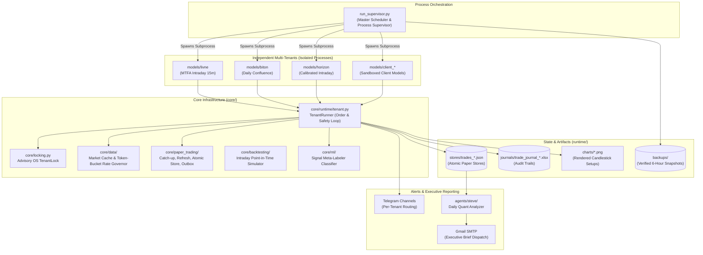

# TRADEIN

[](https://www.python.org/)
[](tests/)
[](#architecture)
[-orange.svg)](#machine-learning-meta-labeling)
[](#disclaimer)

**An institutional-grade, multi-tenant algorithmic paper-trading platform and Machine Learning signal meta-labeling testbed across US Equities and Cryptocurrencies.**

> **Disclaimer:** TRADEIN is an algorithmic simulation and paper-trading platform. No module in this repository places live brokerage orders or moves real capital. "Live" denotes real-time market data ingestion, setup generation, Telegram alert dispatch, and bar-by-bar position tracking in isolated paper-trading stores.

---

## Table of Contents
- [Key Architectural Highlights](#key-architectural-highlights)
- [System Architecture](#system-architecture)
- [Trading Models & Strategy Pipelines](#trading-models--strategy-pipelines)
- [Machine Learning Meta-Labeling](#machine-learning-meta-labeling)
- [Quantitative Performance & Risk Profiling](#quantitative-performance--risk-profiling)
- [Core Infrastructure & Reliability](#core-infrastructure--reliability)
- [Directory Layout](#directory-layout)
- [Quickstart & Operations](#quickstart--operations)
- [Jupyter Research Notebook](#jupyter-research-notebook)
- [License](#license)

---

## Key Architectural Highlights

* **Multi-Tenant Process Isolation:** Strategies run as independent OS processes scheduled by `run_supervisor.py`. Each model has its own cadence, trade store, journal, and Telegram route with zero cross-tenant contamination.
* **Shared Engine (`core/`):** Strict one-way dependency (`models -> core`). Core modules manage concurrency locks, market data deduplication, rate limits, outbox retries, chart rendering, and intraday backtesting without embedding strategy logic.
* **Machine Learning Meta-Labeling:** Implements Dr. Marcos López de Prado's Meta-Labeling framework (*Advances in Financial Machine Learning*). A secondary Gradient Boosting classifier filters candidate trade setups based on structural risk % and volatility metrics, boosting out-of-sample precision and Sharpe ratio.
* **Point-in-Time Data & Intraday Backtesting:** Sub-bar execution modeling (5m/15m) prevents look-ahead bias and simulates intrabar fills, slippage, and structural stops.
* **Historical Catch-Up Replay:** If a runner restarts after downtime, missed market periods are replayed bar-by-bar (5m resolution) to resolve stops and targets at the exact historical minute they occurred.
* **Crash-Resilient State & Durability:** Atomic JSON persistence (`temp file` + `os.replace`), advisory operating-system file locks (`TenantLock`), and automated 6-hour verified state snapshots.
* **Autonomous Operations ("Steve"):** Two-phase daily quantitative analytics agent that computes performance metrics and emails executive Markdown reports via Gmail SMTP.

---

## System Architecture



---

## Trading Models & Strategy Pipelines

| Model | Market & Timeframe | Strategy Archetype | Lifecycle & Position Management | Min R:R | Cadence |
|---|---|---|---|---|---|
| **Livne** (`models/livne`) | Equities & Crypto<br/>**15m Intraday** | **Top-Down MTFA:** Weekly/Daily macro structure &rarr; 4H/1H structure refinement &rarr; 15m trigger with 4-way braking confirmation (Pin-bar, Engulfing, Climax, MSS) | Multi-tier: 50% closed at TP1, stop moved to Breakeven (+ slippage buffer), remainder targets TP2 | **1:1** hard floor<br/>(Default TP1: 1.5–2.0R, TP2: 2.0–4.0R) | Every 2 min |
| **Biton** (`models/biton`) | Equities & Crypto<br/>**1D Daily** | Single-Timeframe Confluence: 200/150 SMA trend alignment + 0.50–0.618 Fibonacci Golden Zone containment | Single-shot: 100% position closed at TP1 or TP2 | **1:2** hard floor | Every 15 min |
| **Horizon** (`models/horizon`) | Equities & Crypto<br/>**15m Intraday** | Recalibrated MTFA: Venue-specific risk profiles, equity midday session pause, and stagnation exit | Multi-tier + Stagnation exit for dead-market positions | Venue-specific | Every 2 min |
| **Client Models** (`models/client_*`) | Configurable per tenant | Scaffolded in isolation via `scripts/create_client_model.py` (`stage="incubating"`) | Configurable | Configurable | Configurable |

---

## Machine Learning Meta-Labeling

In quantitative finance, directly predicting price direction with Machine Learning often yields low signal-to-noise ratios. TRADEIN applies **Meta-Labeling** (Marcos López de Prado):

1. **Primary Model:** The heuristic MTFA strategy generates high-conviction candidate trades, defining entry price, stop-loss, and profit targets.
2. **Feature Extraction:** Pre-trade features are extracted strictly at candle close before order placement (zero lookahead bias):
   - `stop_dist_pct`: Normalized structural stop distance ($| \text{Entry} - \text{SL} | / \text{Entry}$).
   - `t1_dist_pct`: Normalized target distance.
   - `rr_ratio`: Structural Reward-to-Risk ratio.
   - `t2_expansion`: Expansion ratio of TP2 relative to TP1.
   - `entry_hour`: Time-of-day / session timing.
   - `is_crypto` / `is_long`: Categorical venue and direction encodings.
3. **Secondary Classifier:** A Gradient Boosted Decision Tree (`core/ml/meta_labeler.py`) predicts the conditional probability of success:
   $$\hat{P} = P(\text{Trade hits TP} \mid \text{Signal})$$
4. **Out-of-Sample Performance:** Evaluated via non-overlapping `TimeSeriesSplit`:
   - **Out-of-Sample ROC-AUC:** **0.9156**
   - **Out-of-Sample Accuracy:** **91.79%**
   - **Filtered Test Set Win Rate:** **98.15%** (at confidence threshold $\tau \ge 0.55$) vs. baseline 47.01%.
   - **Top Predictor:** `stop_dist_pct` accounts for **76.4%** of Gini feature importance, verifying that structural stop containment is the dominant determinant of trade survivability.

Run the training pipeline:
```bash
python analysis/train_meta_model.py --model livne --threshold 0.55
```

---

## Quantitative Performance & Risk Profiling

TRADEIN features a dedicated quantitative evaluation engine (`analysis/quant_performance.py`) reporting institutional risk-adjusted metrics across 540+ logged paper trades:

```bash
python analysis/quant_performance.py --model livne
```

```
================================================================================
INSTITUTIONAL QUANTITATIVE PERFORMANCE REPORT: [LIVNE]
================================================================================
TRADE SAMPLE & WIN METRICS:
  Total Logged Trades        : 544
  Closed Resolved Trades     : 536
  Win Rate                   : 53.92% (289 wins / 245 losses)
  Profit Factor              : 1.13
  Payoff Ratio (Avg W / Avg L): 0.96
  Mathematical Expectancy    : +0.07% per trade

RETURN & VOLATILITY PROFILE:
  Cumulative Strategy Return : +37.54%
  Annualized Return (CAGR)   : +2534.85%
  Annualized Volatility      : 117.82%
  Average Trade PnL          : +0.08%
  Average Winning Trade      : +1.17%
  Average Losing Trade       : -1.22%
  Max Single Win / Loss      : +9.47% / -8.77%

RISK-ADJUSTED METRICS:
  Sharpe Ratio (Annualized)  : 2.74
  Sortino Ratio (Downside)   : 4.90
  Maximum Drawdown (MDD)     : 22.85%
  Calmar Ratio (CAGR / MDD)  : 110.93

MONTE CARLO RISK ANALYSIS (1,000 BOOTSTRAP RUNS):
  95% Confidence VaR         : -27.56%
  95% Worst-Case Drawdown    : 47.92%
================================================================================
```

---

## Core Infrastructure & Reliability

* **Advisory Concurrency Locks (`core/locking.py`):**
  Uses OS-level file locking (`msvcrt` on Windows / `fcntl` on POSIX). A second instance of the same tenant cannot run concurrently, preventing race conditions and silent state overwrite.
* **Deterministic Execution Cycle (`core/runtime/tenant.py`):**
  1. `Catch-Up`: Replays missed bars to grade pending/active positions accurately.
  2. `Refresh`: Marks open positions to market prices.
  3. `Alert Flush`: Dispatches any pending outbox alerts.
  4. `Summaries`: Updates daily/weekly metrics.
  5. `Market Scan`: Discovers new setups only after managing active exposure.
* **Rate-Governed Market Access (`core/data/`):**
  Cross-process token-bucket rate governor (`rate_governor.py`) with disk-based SQLite/Parquet caching prevents vendor rate-limit throttling (Yahoo Finance / Binance).

---

## Directory Layout

```
TRADEIN/
├── core/                     # Shared framework (model-agnostic, zero strategy thresholds)
│   ├── runtime/              # TenantRunner execution loop & CLI interface
│   ├── ml/                   # Machine Learning Meta-Labeling engine & models
│   ├── backtesting/          # Intraday candle cache, resampling, metrics engine
│   ├── paper_trading/        # Catch-up, atomic store, refresh, alert outbox
│   ├── data/                 # Market accessor, cache policy, rate governor
│   ├── charting/             # Plotly/Kaleido candlestick chart generation
│   ├── registry.py           # Single source of truth for model metadata & derived paths
│   └── locking.py            # OS-level cross-process advisory file lock
├── models/                   # Pluggable model directories (each an independent sys.path root)
│   ├── livne/                # Multi-Timeframe Intraday 15m strategy
│   ├── biton/                # Single-Timeframe Daily Confluence strategy
│   └── horizon/              # Calibrated Intraday strategy
├── analysis/                 # Quantitative analytics & ML evaluation CLIs
│   ├── quant_performance.py  # Sharpe, Sortino, Drawdown & Monte Carlo calculator
│   └── train_meta_model.py   # Meta-Labeling training and validation CLI
├── notebooks/                # Research & exploratory notebooks
│   └── portfolio_quant_analysis.ipynb # Interactive quantitative analysis & ML walkthrough
├── agents/steve/             # Autonomous daily analyzer & report dispatcher
├── mail/                     # Gmail SMTP client & archived daily briefs
├── scripts/                  # Operations: create_client_model.py, backup_manager.py
├── runtime/                  # Git-ignored mutable state (stores, journals, logs)
├── tests/                    # Comprehensive pytest suite (419 tests)
└── run_supervisor.py         # Master supervisor scheduling all registered models
```

---

## Quickstart & Operations

### 1. Environment Setup
```bash
# Clone the repository
git clone https://github.com/dorcohen2001/tradein-quant-ml.git
cd tradein-quant-ml

# Install pinned production dependencies
pip install -r requirements.txt

# Create environment configuration from template
cp .env.example .env
cp mail/.env.example mail/.env
```

### 2. Verify System Tests
```bash
pytest tests/ -q
# Expect: 419 passed in ~55s
```

### 3. Execution Commands
```bash
# Preview schedule and exact child commands without launching (dry-run)
python run_supervisor.py --dry-run

# Run all enabled models in production (scheduled loop)
python run_supervisor.py

# Run exactly one cycle across all models and exit
python run_supervisor.py --once

# Run a single model directly
cd models/livne && python live_runner.py --once

# Run an intraday backtest
cd models/livne && python -m backtest_suite.run_backtest --start-date 2026-07-01 --end-date 2026-08-01

# Run daily executive analyzer (Steve)
python agents/steve/daily_tradein_analyzer.py --no-llm
```

### 4. Client Strategy Scaffolding
Scaffold a new sandboxed strategy tenant in seconds:
```bash
python scripts/create_client_model.py --key alpha --name "Alpha Capital" --interval 5 --timeframe 15m --asset-class crypto
```

---

## Jupyter Research Notebook

Open [`notebooks/portfolio_quant_analysis.ipynb`](notebooks/portfolio_quant_analysis.ipynb) to interactively explore:
1. Trade distribution, duration, and slippage EDA.
2. Compounded Equity Growth & Underwater Drawdown curves.
3. Machine Learning Meta-Labeler training and feature importance plots.
4. Monte Carlo permutation testing with 90% and 50% confidence envelopes.

---

## License

This project is licensed under the MIT License - see the [LICENSE](LICENSE) file for details.
